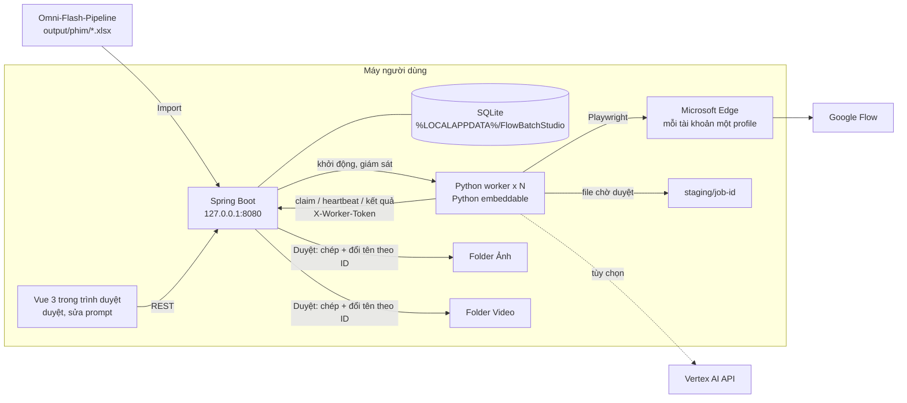
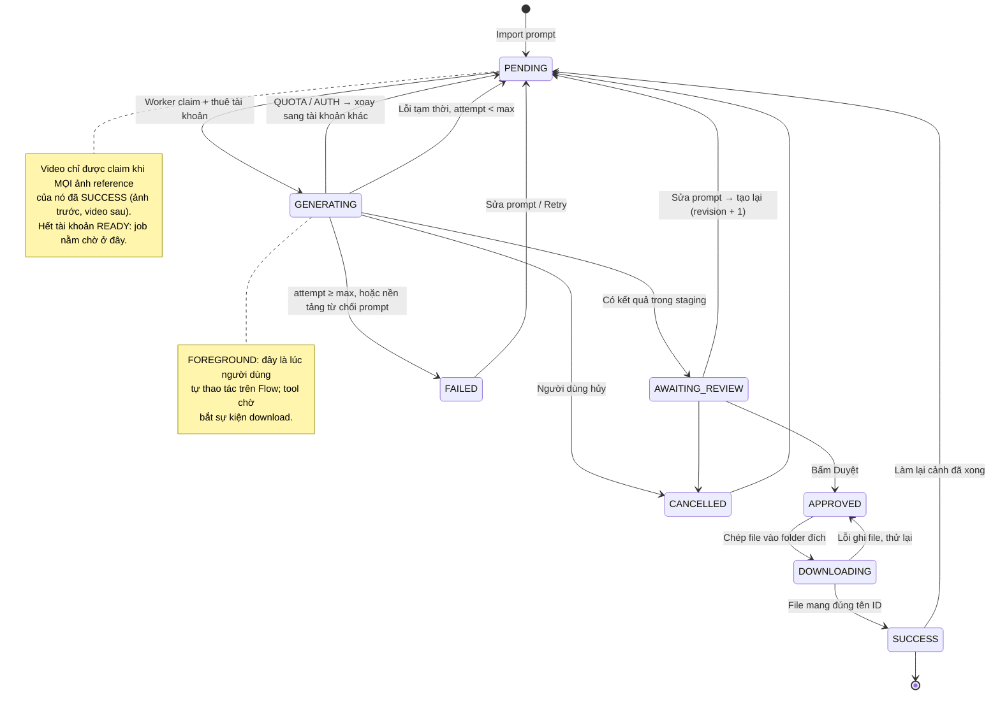
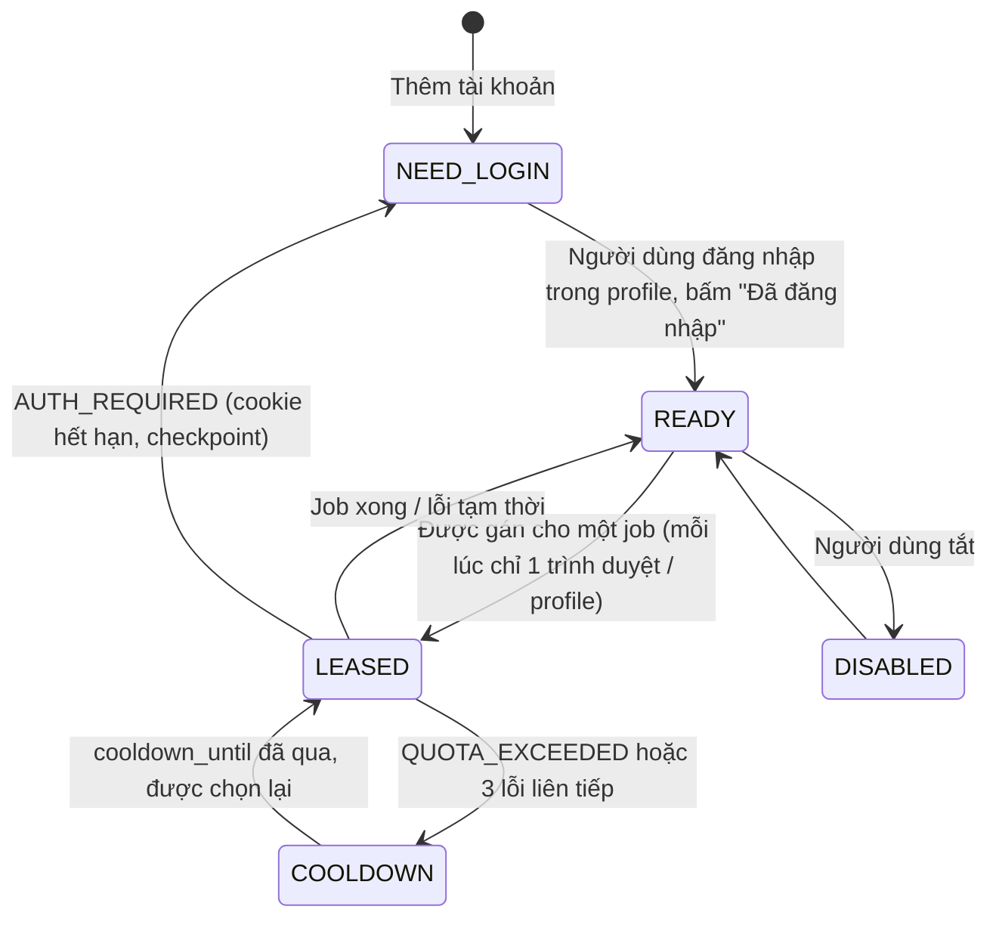
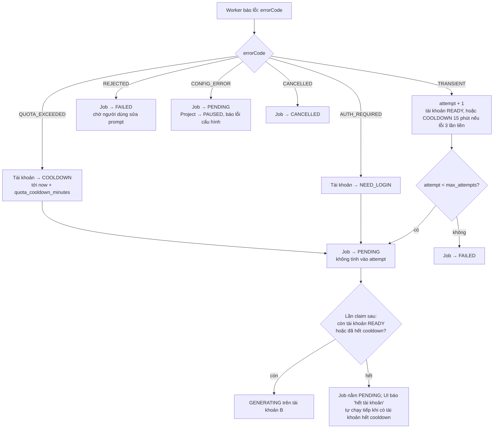

# AI_FILM_MAKER_SYSTEM — Kiến trúc v2

Phạm vi: Bước 3 (ảnh reference) và Bước 4 (video), cơ chế chờ duyệt, xoay vòng tài khoản, hai chế độ chạy, đóng gói 1-click.
Đầu vào: 6 file do Omni-Flash-Pipeline xuất ra (`output/<phim>/`). Một phim mẫu có khoảng 43 ảnh và 298 video.

> Trạng thái tài liệu: thiết kế ban đầu. Code thật đã được viết theo tài liệu này trong `backend/`, `engine/` và `frontend/`, và đã chạy thử trọn vòng bằng driver FAKE. Mọi selector của Google Flow vẫn là chỗ trống phải ghi lại trên giao diện thật (mục 4.4).
>
> **Những điểm code thật khác với tài liệu (rút ra khi chạy thử):**
> - SQLite dùng **1 kết nối** (`hikari.maximum-pool-size: 1`). Khi để nhiều kết nối, hai worker báo kết quả cùng lúc gây lỗi `SQLITE_BUSY_SNAPSHOT` và mất một lần báo.
> - Heartbeat cập nhật bằng câu `UPDATE` trực tiếp (không tăng `@Version`), để không đụng optimistic lock với lần báo kết quả.
> - Import lại so prompt với **bản IMPORT gần nhất**, không so với bản hiện tại, để không ghi đè chỗ người dùng sửa tay.
> - `prompt_references` dùng khóa `id` tự tăng + unique (`video_prompt_id`, `ordinal`).
> - Thêm provider `FAKE` để chạy thử không cần Google.
> - Đóng gói dùng JDK 17 (`jlink --compress=2`) và Python 3.13 embeddable (`python313._pth`). Build trong `C:\fbs-build`.
> - Bộ cài mặc định vào `C:\FlowBatchStudio` thay vì `%LOCALAPPDATA%\Programs`, vì launcher jpackage không chạy trong đường dẫn có dấu.

---

## 0. Các quyết định kiến trúc (và chỗ lệch so với yêu cầu)

| # | Yêu cầu | Quyết định | Lý do |
|---|---|---|---|
| 1 | MySQL | DDL viết theo MySQL 8 (mục 2). **Bản đóng gói cho người dùng chạy SQLite** (đang dùng sẵn); JPA giữ nguyên, đổi DB chỉ là đổi `application.yml`. | Muốn bundle MySQL thì phải cài service, cần quyền admin, tốn hơn 200 MB và dễ xung đột cổng. Điều đó trái với yêu cầu "1-click, không cài gì". MySQL hợp khi sau này chạy máy chủ dùng chung. |
| 2 | Python đọc ID từ Database | Python **không** ghi DB trực tiếp. Worker gọi API nội bộ của Spring: `claim`, `heartbeat`, báo kết quả. | Nếu chỉ một tiến trình ghi DB thì không có tranh chấp khóa SQLite, và trạng thái job/tài khoản có đúng một nơi quyết định. Python không giữ trạng thái nên chết lúc nào cũng được. |
| 3 | Chỉ tải file về sau khi duyệt | Kết quả được tải vào **thư mục tạm (staging)** để xem trước. Bấm Duyệt thì Spring **chép + đổi tên theo ID** vào Folder Ảnh / Folder Video. Folder của người dùng chỉ nhận file đã duyệt. | Muốn duyệt video thì phải xem được video; một ảnh chụp thumbnail không đủ để duyệt diễn xuất. Cách này còn bỏ được việc mở lại trình duyệt sau khi duyệt. |
| 4 | Background = "gửi API" | Có hai provider: `FLOW_BROWSER` (Playwright tự thao tác trên Flow, không cần người) và `VERTEX_API` (API chính thức Imagen/Veo). | Google Flow **không có API công khai**. Vertex là đường có API, nhưng giới hạn ảnh reference cho video thấp hơn mức 7 ảnh mà prompt Omni đang dùng (mục 4.5). Vì vậy prompt Omni mặc định đi qua `FLOW_BROWSER`. |
| 5 | Một file .exe | Inno Setup tạo **một file Setup.exe**. Cài xong, người dùng bấm đúp `FlowBatchStudio.exe`; launcher này do `jpackage` tạo, đã gói sẵn JRE. | Kiểu exe tự giải nén mỗi lần chạy thì khởi động chậm và hay bị antivirus chặn nhầm. |
| 6 | Lưu Cookie/Token | Cookie nằm trong **thư mục profile Edge riêng của từng tài khoản**, không lưu vào DB. Với Vertex, DB chỉ giữ **đường dẫn** file service-account, không giữ nội dung. | DB không chứa bí mật. Server chỉ nghe ở `127.0.0.1`. |

**Lưu ý điều khoản:** dùng nhiều tài khoản Google cá nhân xoay vòng để vượt giới hạn của Flow nhiều khả năng trái điều khoản sử dụng của Google, và có thể bị khóa tài khoản. Thiết kế này xoay vòng khi gặp lỗi quota nhưng **không thêm kỹ thuật che giấu tự động hóa**. Nếu cần chạy quy mô lớn và ổn định, đường chính thức là Vertex AI với quota xin nâng theo từng project.

---

## 1. Kiến trúc & luồng

### 1.1 Thành phần



### 1.2 State machine của Job (một job = một prompt ảnh hoặc video)



### 1.3 State machine của Tài khoản



### 1.4 Nhánh xử lý lỗi và xoay vòng tài khoản



Tài khoản A bị loại khỏi lượt chọn sau vì nó không còn ở trạng thái `READY`. Vì vậy không cần lưu danh sách "tài khoản đã thử" cho từng job.

### 1.5 Hai chế độ chạy

| | BACKGROUND | FOREGROUND |
|---|---|---|
| Ai bấm Generate | Worker | Người dùng, trên Flow |
| Trình duyệt | Edge của profile tài khoản; mở có cửa sổ hay ẩn tùy setting `headless` (Flow có thể chặn chế độ headless, nên thử trước) | Edge mở có cửa sổ, **đã điền sẵn prompt + ảnh reference** |
| Lấy kết quả | Worker chờ thẻ kết quả rồi tự bấm Download | **Hook `context.on("download")`**: người dùng bấm Download trên Flow thì file tự về staging, đặt tên theo ID |
| Song song | `max_parallel` của project | Ép bằng 1 (một màn hình, một người) |
| Sau đó | AWAITING_REVIEW → duyệt trên Vue | Giống bên trái |

### 1.6 Thứ tự chạy và nút thắt thật

- **Ảnh trước, video sau**: video chỉ chạy khi mọi `Reference IDs` của nó đã SUCCESS, vì worker upload chính file trong Folder Ảnh. Nếu tạo lại một ảnh, mọi video chưa xong dùng ảnh đó sẽ tự chờ.
- Với 341 mục cần duyệt cho mỗi phim, **nút thắt là khâu duyệt chứ không phải khâu render**. Màn duyệt vì vậy dùng phím tắt (A = duyệt, R = tạo lại, ←/→ = chuyển mục), và có thêm "Duyệt các mục đã chọn".

---

## 2. Database (MySQL 8)

Quy ước: trạng thái lưu bằng `VARCHAR` + `CHECK` thay vì `ENUM`, để cùng một schema chạy được trên SQLite. MySQL thực thi `CHECK` từ bản 8.0.16.

```sql
-- ============ TÀI KHOẢN (xoay vòng) ============
CREATE TABLE accounts (
  id                   BIGINT       PRIMARY KEY AUTO_INCREMENT,
  email                VARCHAR(255) NOT NULL UNIQUE,
  provider             VARCHAR(20)  NOT NULL DEFAULT 'FLOW_BROWSER',
  profile_dir          VARCHAR(500) NULL,     -- FLOW_BROWSER: thư mục profile Edge (cookie nằm ở đây)
  credential_file      VARCHAR(500) NULL,     -- VERTEX_API: đường dẫn file service-account JSON (không lưu nội dung)
  gcp_project          VARCHAR(100) NULL,
  gcp_location         VARCHAR(50)  NULL,
  proxy                VARCHAR(255) NULL,
  status               VARCHAR(20)  NOT NULL DEFAULT 'NEED_LOGIN',
  priority             INT          NOT NULL DEFAULT 100,   -- nhỏ = ưu tiên
  cooldown_until       DATETIME     NULL,
  leased_job_id        BIGINT       NULL,
  consecutive_failures INT          NOT NULL DEFAULT 0,
  daily_image_limit    INT          NULL,     -- NULL = không tự giới hạn
  daily_video_limit    INT          NULL,
  used_images_today    INT          NOT NULL DEFAULT 0,
  used_videos_today    INT          NOT NULL DEFAULT 0,
  usage_date           DATE         NULL,
  last_error_message   VARCHAR(2000) NULL,
  last_used_at         DATETIME     NULL,
  version              INT          NOT NULL DEFAULT 0,      -- optimistic lock (JPA @Version)
  created_at           DATETIME     NOT NULL DEFAULT CURRENT_TIMESTAMP,
  updated_at           DATETIME     NOT NULL DEFAULT CURRENT_TIMESTAMP ON UPDATE CURRENT_TIMESTAMP,
  CONSTRAINT chk_acc_provider CHECK (provider IN ('FLOW_BROWSER','VERTEX_API')),
  CONSTRAINT chk_acc_status   CHECK (status IN ('READY','LEASED','COOLDOWN','NEED_LOGIN','DISABLED'))
) ENGINE=InnoDB DEFAULT CHARSET=utf8mb4 COLLATE=utf8mb4_unicode_ci;

CREATE INDEX idx_acc_pick ON accounts (provider, status, cooldown_until, priority, last_used_at);

-- ============ PROJECT (một phim) ============
CREATE TABLE projects (
  id             BIGINT       PRIMARY KEY AUTO_INCREMENT,
  code           VARCHAR(100) NOT NULL UNIQUE,   -- khóa phim (KHÔNG dùng tên file xlsx: mọi phim đều tên all-video-prompts.xlsx)
  name           VARCHAR(255) NOT NULL,
  source_dir     VARCHAR(500) NOT NULL,          -- output/<phim>/ của Omni-Flash-Pipeline
  image_dir      VARCHAR(500) NOT NULL,          -- Folder Ảnh do người dùng chọn
  video_dir      VARCHAR(500) NOT NULL,          -- Folder Video do người dùng chọn
  run_mode       VARCHAR(20)  NOT NULL DEFAULT 'BACKGROUND',
  provider       VARCHAR(20)  NOT NULL DEFAULT 'FLOW_BROWSER',
  flow_project_url VARCHAR(1000) NULL,           -- dự án Flow dùng chung cho phim (tùy chọn)
  aspect_ratio   VARCHAR(10)  NOT NULL DEFAULT '16:9',
  max_parallel   INT          NOT NULL DEFAULT 3,
  max_attempts   INT          NOT NULL DEFAULT 3,
  status         VARCHAR(20)  NOT NULL DEFAULT 'DRAFT',
  paused_reason  VARCHAR(2000) NULL,
  created_at     DATETIME     NOT NULL DEFAULT CURRENT_TIMESTAMP,
  updated_at     DATETIME     NOT NULL DEFAULT CURRENT_TIMESTAMP ON UPDATE CURRENT_TIMESTAMP,
  CONSTRAINT chk_prj_mode     CHECK (run_mode IN ('BACKGROUND','FOREGROUND')),
  CONSTRAINT chk_prj_provider CHECK (provider IN ('FLOW_BROWSER','VERTEX_API')),
  CONSTRAINT chk_prj_status   CHECK (status IN ('DRAFT','RUNNING','PAUSED','DONE'))
) ENGINE=InnoDB DEFAULT CHARSET=utf8mb4 COLLATE=utf8mb4_unicode_ci;

-- ============ PROMPT ============
CREATE TABLE prompts (
  id                  BIGINT       PRIMARY KEY AUTO_INCREMENT,
  project_id          BIGINT       NOT NULL,
  kind                VARCHAR(10)  NOT NULL,     -- IMAGE | VIDEO
  external_id         VARCHAR(100) NOT NULL,     -- IMAGE: CHAR-DOMINIC-1, LOC-1, PROP-2 ; VIDEO: 001..298
  seq_no              INT          NOT NULL,     -- cột STT trong xlsx
  summary_vi          TEXT         NULL,         -- cột "Tóm tắt segment (tiếng Việt)"
  current_revision_id BIGINT       NULL,
  created_at          DATETIME     NOT NULL DEFAULT CURRENT_TIMESTAMP,
  CONSTRAINT uq_prompt UNIQUE (project_id, kind, external_id),
  CONSTRAINT chk_prompt_kind CHECK (kind IN ('IMAGE','VIDEO')),
  CONSTRAINT chk_prompt_extid CHECK (external_id REGEXP '^[A-Za-z0-9][A-Za-z0-9_-]{0,99}$'), -- an toàn làm tên file Windows
  CONSTRAINT fk_prompt_project FOREIGN KEY (project_id) REFERENCES projects(id) ON DELETE CASCADE
) ENGINE=InnoDB DEFAULT CHARSET=utf8mb4 COLLATE=utf8mb4_unicode_ci;

CREATE TABLE prompt_revisions (
  id           BIGINT       PRIMARY KEY AUTO_INCREMENT,
  prompt_id    BIGINT       NOT NULL,
  revision_no  INT          NOT NULL,
  prompt_text  MEDIUMTEXT   NOT NULL,           -- prompt lean trung bình khoảng 6.700 ký tự, vượt TEXT 64KB khi ghép nhiều
  source       VARCHAR(10)  NOT NULL,           -- IMPORT | USER
  note         VARCHAR(2000) NULL,
  created_at   DATETIME     NOT NULL DEFAULT CURRENT_TIMESTAMP,
  CONSTRAINT uq_revision UNIQUE (prompt_id, revision_no),
  CONSTRAINT chk_rev_source CHECK (source IN ('IMPORT','USER')),
  CONSTRAINT fk_rev_prompt FOREIGN KEY (prompt_id) REFERENCES prompts(id) ON DELETE CASCADE
) ENGINE=InnoDB DEFAULT CHARSET=utf8mb4 COLLATE=utf8mb4_unicode_ci;

ALTER TABLE prompts ADD CONSTRAINT fk_prompt_current_rev
  FOREIGN KEY (current_revision_id) REFERENCES prompt_revisions(id) ON DELETE SET NULL;

-- Video → các ảnh reference, theo đúng thứ tự cột "Reference IDs" (= thứ tự upload)
CREATE TABLE prompt_references (
  video_prompt_id  BIGINT       NOT NULL,
  ordinal          INT          NOT NULL,
  ref_external_id  VARCHAR(100) NOT NULL,
  PRIMARY KEY (video_prompt_id, ordinal),
  CONSTRAINT fk_ref_prompt FOREIGN KEY (video_prompt_id) REFERENCES prompts(id) ON DELETE CASCADE
) ENGINE=InnoDB DEFAULT CHARSET=utf8mb4 COLLATE=utf8mb4_unicode_ci;

-- ============ JOB (một job cho mỗi prompt; tạo lại = đưa chính job đó về PENDING) ============
CREATE TABLE jobs (
  id               BIGINT       PRIMARY KEY AUTO_INCREMENT,
  project_id       BIGINT       NOT NULL,
  prompt_id        BIGINT       NOT NULL UNIQUE,
  revision_id      BIGINT       NULL,           -- revision đã dùng để sinh kết quả đang chờ duyệt
  kind             VARCHAR(10)  NOT NULL,
  status           VARCHAR(20)  NOT NULL DEFAULT 'PENDING',
  account_id       BIGINT       NULL,
  worker_id        VARCHAR(100) NULL,
  attempt          INT          NOT NULL DEFAULT 0,
  cancel_requested BOOLEAN      NOT NULL DEFAULT FALSE,
  remote_ref       VARCHAR(1000) NULL,          -- URL trên Flow / operation Vertex (để mở lại xem)
  preview_path     VARCHAR(1000) NULL,          -- file trong staging
  final_path       VARCHAR(1000) NULL,          -- file trong Folder Ảnh / Folder Video sau khi duyệt
  error_code       VARCHAR(30)  NULL,
  error_message    VARCHAR(2000) NULL,
  review_note      VARCHAR(2000) NULL,
  heartbeat_at     DATETIME     NULL,
  started_at       DATETIME     NULL,
  generated_at     DATETIME     NULL,
  reviewed_at      DATETIME     NULL,
  completed_at     DATETIME     NULL,
  version          INT          NOT NULL DEFAULT 0,
  created_at       DATETIME     NOT NULL DEFAULT CURRENT_TIMESTAMP,
  updated_at       DATETIME     NOT NULL DEFAULT CURRENT_TIMESTAMP ON UPDATE CURRENT_TIMESTAMP,
  CONSTRAINT chk_job_status CHECK (status IN ('PENDING','GENERATING','AWAITING_REVIEW','APPROVED',
                                              'DOWNLOADING','SUCCESS','FAILED','CANCELLED')),
  CONSTRAINT fk_job_project FOREIGN KEY (project_id) REFERENCES projects(id) ON DELETE CASCADE,
  CONSTRAINT fk_job_prompt  FOREIGN KEY (prompt_id)  REFERENCES prompts(id)  ON DELETE CASCADE,
  CONSTRAINT fk_job_rev     FOREIGN KEY (revision_id) REFERENCES prompt_revisions(id) ON DELETE SET NULL,
  CONSTRAINT fk_job_account FOREIGN KEY (account_id) REFERENCES accounts(id) ON DELETE SET NULL
) ENGINE=InnoDB DEFAULT CHARSET=utf8mb4 COLLATE=utf8mb4_unicode_ci;

CREATE INDEX idx_jobs_sched     ON jobs (project_id, status, kind);
CREATE INDEX idx_jobs_heartbeat ON jobs (status, heartbeat_at);

-- Nhật ký chuyển trạng thái: lịch sử tạo lại, xoay tài khoản, ai duyệt lúc nào
CREATE TABLE job_events (
  id           BIGINT      PRIMARY KEY AUTO_INCREMENT,
  job_id       BIGINT      NOT NULL,
  from_status  VARCHAR(20) NULL,
  to_status    VARCHAR(20) NOT NULL,
  account_id   BIGINT      NULL,
  message      VARCHAR(2000) NULL,
  created_at   DATETIME    NOT NULL DEFAULT CURRENT_TIMESTAMP,
  CONSTRAINT fk_evt_job FOREIGN KEY (job_id) REFERENCES jobs(id) ON DELETE CASCADE
) ENGINE=InnoDB DEFAULT CHARSET=utf8mb4 COLLATE=utf8mb4_unicode_ci;

CREATE INDEX idx_evt_job ON job_events (job_id, created_at);

-- app_settings: giữ bảng hiện có (key/value). Khóa mới: worker_processes, quota_cooldown_minutes,
-- job_timeout_minutes, staging_retention_days.
```

**Quy tắc đặt tên file:**

| Loại | `external_id` | File cuối |
|---|---|---|
| Ảnh | đúng cột `Reference ID` của `reference-prompts.xlsx`, ví dụ `CHAR-DOMINIC-1` | `<Folder Ảnh>/CHAR-DOMINIC-1.png` |
| Video | cột `STT segment`, đệm số 0 theo tổng số video (298 → 3 chữ số) | `<Folder Video>/<mã phim>_042.mp4`, ví dụ `tap-5-ha-cupid_042.mp4` (đổi 2026-11-03: gộp video nhiều phim một thư mục không trùng tên) |

Phần mở rộng (`.png`, `.jpg`, `.mp4`) lấy theo file thật mà nền tảng trả về.

---

## 3. Spring Boot

Package giữ nguyên `com.aifilm.automation`. Các phần mới: `job/` (state machine, claim, kết quả, duyệt), `worker/` (API cho Python + supervisor), `system/` (đường dẫn, mở trình duyệt, một phiên bản duy nhất).

### 3.1 Trạng thái + chuyển trạng thái có kiểm tra

```java
package com.aifilm.automation.job;

import java.util.EnumMap;
import java.util.EnumSet;
import java.util.Map;
import java.util.Set;

public enum JobStatus {
    PENDING, GENERATING, AWAITING_REVIEW, APPROVED, DOWNLOADING, SUCCESS, FAILED, CANCELLED;

    private static final Map<JobStatus, Set<JobStatus>> NEXT = new EnumMap<>(JobStatus.class);
    static {
        NEXT.put(PENDING,         EnumSet.of(GENERATING, CANCELLED));
        NEXT.put(GENERATING,      EnumSet.of(AWAITING_REVIEW, PENDING, FAILED, CANCELLED));
        NEXT.put(AWAITING_REVIEW, EnumSet.of(APPROVED, PENDING, CANCELLED));
        NEXT.put(APPROVED,        EnumSet.of(DOWNLOADING, PENDING, CANCELLED));
        NEXT.put(DOWNLOADING,     EnumSet.of(SUCCESS, APPROVED));
        NEXT.put(SUCCESS,         EnumSet.of(PENDING));
        NEXT.put(FAILED,          EnumSet.of(PENDING, CANCELLED));
        NEXT.put(CANCELLED,       EnumSet.of(PENDING));
    }

    public boolean canMoveTo(JobStatus to) {
        return NEXT.get(this).contains(to);
    }
}
```

```java
package com.aifilm.automation.job;

public enum ErrorCode {
    QUOTA_EXCEEDED, AUTH_REQUIRED, REJECTED, TRANSIENT, CANCELLED, CONFIG_ERROR;

    public static ErrorCode parse(String s) {
        try { return valueOf(s); } catch (RuntimeException e) { return TRANSIENT; }
    }
}
```

```java
package com.aifilm.automation.job;

import lombok.RequiredArgsConstructor;
import org.springframework.stereotype.Component;

@Component
@RequiredArgsConstructor
public class JobTransitions {
    private final JobEventRepository events;

    /** Mọi thay đổi trạng thái đi qua đây: chặn chuyển sai và ghi nhật ký. Gọi bên trong một transaction. */
    public void move(JobEntity job, JobStatus to, Long accountId, String message) {
        JobStatus from = job.getStatus();
        if (!from.canMoveTo(to)) {
            throw new IllegalStateException("Job " + job.getId() + ": không thể chuyển " + from + " → " + to);
        }
        job.setStatus(to);
        events.save(new JobEventEntity(job.getId(), from, to, accountId, message));
    }
}
```

### 3.2 Entity (rút gọn)

```java
@Entity @Table(name = "jobs")
@Getter @Setter @NoArgsConstructor
public class JobEntity {
    @Id @GeneratedValue(strategy = GenerationType.IDENTITY) private Long id;
    private Long projectId;
    private Long promptId;
    private Long revisionId;
    @Enumerated(EnumType.STRING) private PromptKind kind;
    @Enumerated(EnumType.STRING) private JobStatus status = JobStatus.PENDING;
    private Long accountId;
    private String workerId;
    private int attempt;
    private boolean cancelRequested;
    private String remoteRef;
    private String previewPath;
    private String finalPath;
    private String errorCode;
    @Column(length = 2000) private String errorMessage;
    @Column(length = 2000) private String reviewNote;
    private LocalDateTime heartbeatAt, startedAt, generatedAt, reviewedAt, completedAt;
    @Version private int version;
}
```

```java
@Entity @Table(name = "accounts")
@Getter @Setter @NoArgsConstructor
public class AccountEntity {
    @Id @GeneratedValue(strategy = GenerationType.IDENTITY) private Long id;
    private String email;
    @Enumerated(EnumType.STRING) private Provider provider;
    private String profileDir, credentialFile, gcpProject, gcpLocation, proxy;
    @Enumerated(EnumType.STRING) private AccountStatus status = AccountStatus.NEED_LOGIN;
    private int priority = 100;
    private LocalDateTime cooldownUntil, lastUsedAt;
    private Long leasedJobId;
    private int consecutiveFailures;
    @Column(length = 2000) private String lastErrorMessage;
    @Version private int version;

    public void lease(long jobId, LocalDateTime now) {
        status = AccountStatus.LEASED; leasedJobId = jobId; lastUsedAt = now;
    }
    public void releaseOk() {
        status = AccountStatus.READY; leasedJobId = null; consecutiveFailures = 0;
    }
    public void releaseAfterError(String msg) {
        leasedJobId = null; lastErrorMessage = msg;
        if (++consecutiveFailures >= 3) { status = AccountStatus.COOLDOWN; cooldownUntil = LocalDateTime.now().plusMinutes(15); }
        else status = AccountStatus.READY;
    }
    public void cooldown(LocalDateTime until, String msg) {
        status = AccountStatus.COOLDOWN; cooldownUntil = until; leasedJobId = null; lastErrorMessage = msg;
    }
    public void needLogin(String msg) {
        status = AccountStatus.NEED_LOGIN; leasedJobId = null; lastErrorMessage = msg;
    }
}
```

### 3.3 Truy vấn chọn job và chọn tài khoản

Viết bằng native SQL để chạy được trên cả MySQL lẫn SQLite.

```java
public interface JobRepository extends JpaRepository<JobEntity, Long> {

    /** Job PENDING kế tiếp: ảnh trước video; video chỉ khi MỌI ảnh reference đã SUCCESS. */
    @Query(value = """
        SELECT j.* FROM jobs j
        JOIN prompts p ON p.id = j.prompt_id
        WHERE j.project_id = :projectId AND j.status = 'PENDING'
          AND NOT EXISTS (
              SELECT 1 FROM prompt_references r
              LEFT JOIN prompts ip ON ip.project_id = p.project_id AND ip.kind = 'IMAGE'
                                  AND ip.external_id = r.ref_external_id
              LEFT JOIN jobs ij ON ij.prompt_id = ip.id
              WHERE r.video_prompt_id = p.id AND (ij.id IS NULL OR ij.status <> 'SUCCESS'))
        ORDER BY CASE p.kind WHEN 'IMAGE' THEN 0 ELSE 1 END, p.seq_no
        LIMIT 1""", nativeQuery = true)
    Optional<JobEntity> findNextRunnable(@Param("projectId") long projectId);

    long countByProjectIdAndStatus(long projectId, JobStatus status);

    List<JobEntity> findByStatusAndHeartbeatAtBefore(JobStatus status, LocalDateTime limit);

    List<JobEntity> findByStatus(JobStatus status);
}

public interface AccountRepository extends JpaRepository<AccountEntity, Long> {

    /** Tài khoản rảnh: READY, hoặc COOLDOWN đã hết hạn. Ưu tiên priority, rồi tài khoản lâu chưa dùng nhất. */
    @Query(value = """
        SELECT * FROM accounts
        WHERE provider = :provider
          AND (status = 'READY' OR (status = 'COOLDOWN' AND cooldown_until <= :now))
        ORDER BY priority ASC, (last_used_at IS NULL) DESC, last_used_at ASC
        LIMIT 1""", nativeQuery = true)
    Optional<AccountEntity> findNextAvailable(@Param("provider") String provider, @Param("now") LocalDateTime now);

    List<AccountEntity> findByStatus(AccountStatus status);
}
```

### 3.4 Claim: giao job + thuê tài khoản (không bao giờ có 2 trình duyệt cùng một profile)

```java
@Service
@RequiredArgsConstructor
public class JobClaimService {
    private final JobRepository jobs;
    private final AccountRepository accounts;
    private final ProjectRepository projects;
    private final JobTransitions transitions;
    private final JobPayloadFactory payloads;
    private final TransactionTemplate tx;
    private final ReentrantLock claimLock = new ReentrantLock();

    /**
     * Chỉ có một backend, nên khóa trong JVM bọc NGOÀI transaction là đủ để hai worker không giành
     * cùng job/tài khoản. Lock được nhả sau khi commit. Nếu sau này chạy nhiều backend trên MySQL,
     * thay bằng SELECT ... FOR UPDATE SKIP LOCKED.
     */
    public Optional<JobPayload> claim(String workerId) {
        claimLock.lock();
        try {
            return tx.execute(status -> claimInTx(workerId));
        } finally {
            claimLock.unlock();
        }
    }

    private Optional<JobPayload> claimInTx(String workerId) {
        LocalDateTime now = LocalDateTime.now();
        for (ProjectEntity p : projects.findByStatus(ProjectStatus.RUNNING)) {
            int parallel = p.getRunMode() == RunMode.FOREGROUND ? 1 : p.getMaxParallel();
            if (jobs.countByProjectIdAndStatus(p.getId(), JobStatus.GENERATING) >= parallel) continue;

            Optional<JobEntity> next = jobs.findNextRunnable(p.getId());
            if (next.isEmpty()) continue;

            Optional<AccountEntity> acc = accounts.findNextAvailable(p.getProvider().name(), now);
            if (acc.isEmpty()) continue;            // UI hiển thị "hết tài khoản"; job giữ PENDING

            JobEntity job = next.get();
            AccountEntity a = acc.get();
            a.lease(job.getId(), now);
            job.setAccountId(a.getId());
            job.setWorkerId(workerId);
            job.setStartedAt(now);
            job.setHeartbeatAt(now);
            job.setCancelRequested(false);
            transitions.move(job, JobStatus.GENERATING, a.getId(), "claim bởi " + workerId);
            return Optional.of(payloads.forGenerate(job, p, a));
        }
        return Optional.empty();
    }
}
```

```java
/** Toàn bộ dữ liệu worker cần, gói một lần. Python không đọc DB. */
public record JobPayload(
        long jobId, String kind, String provider, String runMode,
        String externalId, String prompt, List<String> referenceImages,
        Map<String, Object> account,      // id, email, profileDir, proxy, credentialFile, gcpProject, gcpLocation
        String stagingDir, String flowProjectUrl, String aspectRatio,
        int timeoutSeconds, boolean headless) {}
```

Bên trong `JobPayloadFactory.forGenerate`, hai điểm quan trọng:

- `prompt` lấy từ `current_revision_id` **tại thời điểm claim**, đồng thời gán `job.revisionId` bằng revision đó.
- `referenceImages` là `final_path` của các job ảnh đã SUCCESS, theo đúng `ordinal`.
- `stagingDir` có dạng `%LOCALAPPDATA%/FlowBatchStudio/staging/job-<id>/rev-<revisionId>`.

### 3.5 Nhận kết quả, xoay vòng tài khoản, thu hồi worker chết

```java
@Service
@RequiredArgsConstructor
public class JobResultService {
    private final JobRepository jobs;
    private final AccountRepository accounts;
    private final ProjectRepository projects;
    private final JobTransitions transitions;
    private final AppSettingsService settings;

    @Transactional
    public void onGenerated(long jobId, GeneratedReport r) {
        JobEntity job = owned(jobId, r.workerId());
        Path staged = StagingGuard.requireInside(Path.of(r.stagedFile()));   // chặn đường dẫn ngoài staging
        job.setPreviewPath(staged.toString());
        job.setRemoteRef(r.remoteRef());
        job.setGeneratedAt(LocalDateTime.now());
        job.setErrorCode(null);
        job.setErrorMessage(null);
        transitions.move(job, JobStatus.AWAITING_REVIEW, job.getAccountId(), "có kết quả, chờ duyệt");
        accounts.findById(job.getAccountId()).ifPresent(AccountEntity::releaseOk);
    }

    @Transactional
    public void onFailed(long jobId, FailureReport r) {
        JobEntity job = owned(jobId, r.workerId());
        AccountEntity acc = accounts.findById(job.getAccountId()).orElseThrow();
        ErrorCode code = ErrorCode.parse(r.errorCode());
        job.setErrorCode(code.name());
        job.setErrorMessage(r.message());

        switch (code) {
            case QUOTA_EXCEEDED -> {
                int minutes = settings.getIntSetting("quota_cooldown_minutes", 360);
                acc.cooldown(LocalDateTime.now().plusMinutes(minutes), r.message());
                requeue(job, acc, "hết quota → xoay sang tài khoản khác");      // không tính attempt
            }
            case AUTH_REQUIRED -> {
                acc.needLogin(r.message());
                requeue(job, acc, "phiên đăng nhập hỏng → xoay sang tài khoản khác");
            }
            case TRANSIENT -> {
                acc.releaseAfterError(r.message());
                job.setAttempt(job.getAttempt() + 1);
                int max = projects.findById(job.getProjectId()).map(ProjectEntity::getMaxAttempts).orElse(3);
                if (job.getAttempt() < max) requeue(job, acc, "thử lại " + job.getAttempt() + "/" + max);
                else transitions.move(job, JobStatus.FAILED, acc.getId(), "hết lượt thử");
            }
            case REJECTED -> {
                acc.releaseOk();
                transitions.move(job, JobStatus.FAILED, acc.getId(), "nền tảng từ chối: cần sửa prompt");
            }
            case CONFIG_ERROR -> {
                acc.releaseOk();
                requeue(job, acc, "lỗi cấu hình worker");
                projects.findById(job.getProjectId()).ifPresent(p -> p.pause("CONFIG_ERROR: " + r.message()));
            }
            case CANCELLED -> {
                acc.releaseOk();
                transitions.move(job, JobStatus.CANCELLED, acc.getId(), "người dùng hủy");
            }
        }
    }

    /** Worker im lặng quá 5 phút (crash, máy ngủ): coi như lỗi tạm thời để job và tài khoản không kẹt mãi. */
    @Scheduled(fixedDelay = 60_000)
    @Transactional
    public void reapStaleJobs() {
        LocalDateTime limit = LocalDateTime.now().minusMinutes(5);
        for (JobEntity job : jobs.findByStatusAndHeartbeatAtBefore(JobStatus.GENERATING, limit)) {
            onFailed(job.getId(), new FailureReport(job.getWorkerId(), "TRANSIENT", "Worker mất liên lạc quá 5 phút"));
        }
    }

    /** Lúc khởi động: mọi việc dở dang từ lần chạy trước được trả về hàng đợi. */
    @EventListener(ApplicationReadyEvent.class)
    @Transactional
    public void recoverAfterRestart() {
        for (JobEntity job : jobs.findByStatus(JobStatus.GENERATING)) {
            job.setAccountId(null);
            job.setWorkerId(null);
            transitions.move(job, JobStatus.PENDING, null, "khôi phục sau khi khởi động lại");
        }
        accounts.findByStatus(AccountStatus.LEASED).forEach(AccountEntity::releaseOk);
    }

    @Transactional
    public boolean heartbeat(long jobId, String workerId) {
        JobEntity job = owned(jobId, workerId);
        job.setHeartbeatAt(LocalDateTime.now());
        return job.isCancelRequested();           // worker đọc cờ này để dừng
    }

    private void requeue(JobEntity job, AccountEntity acc, String why) {
        job.setAccountId(null);
        job.setWorkerId(null);
        transitions.move(job, JobStatus.PENDING, acc.getId(), why);
    }

    private JobEntity owned(long jobId, String workerId) {
        JobEntity job = jobs.findById(jobId).orElseThrow();
        if (job.getStatus() != JobStatus.GENERATING || !Objects.equals(job.getWorkerId(), workerId)) {
            throw new JobNotOwnedException(jobId, workerId);   // ví dụ: reaper đã thu hồi, worker cũ báo muộn
        }
        return job;
    }
}
```

### 3.6 Duyệt / tạo lại / hủy

```java
@Service
@RequiredArgsConstructor
public class ReviewService {
    private final JobRepository jobs;
    private final PromptRepository prompts;
    private final PromptRevisionRepository revisions;
    private final ProjectRepository projects;
    private final JobTransitions transitions;

    /** Duyệt: chép file staging vào folder đích, tên = external_id. Lỗi ghi file → rollback, job vẫn AWAITING_REVIEW. */
    @Transactional
    public JobEntity approve(long jobId) throws IOException {
        JobEntity job = jobs.findById(jobId).orElseThrow();
        PromptEntity prompt = prompts.findById(job.getPromptId()).orElseThrow();
        ProjectEntity project = projects.findById(job.getProjectId()).orElseThrow();

        transitions.move(job, JobStatus.APPROVED, job.getAccountId(), "người dùng duyệt");
        job.setReviewedAt(LocalDateTime.now());
        transitions.move(job, JobStatus.DOWNLOADING, job.getAccountId(), "chép vào folder đích");

        Path staged = Path.of(job.getPreviewPath());
        String ext = extensionOf(staged.getFileName().toString());
        Path dir = Path.of(prompt.getKind() == PromptKind.IMAGE ? project.getImageDir() : project.getVideoDir());
        Path target = dir.resolve(prompt.getExternalId() + ext);

        Files.createDirectories(dir);
        Path part = target.resolveSibling(target.getFileName() + ".part");
        Files.copy(staged, part, StandardCopyOption.REPLACE_EXISTING);
        Files.move(part, target, StandardCopyOption.REPLACE_EXISTING, StandardCopyOption.ATOMIC_MOVE);

        job.setFinalPath(target.toString());
        job.setCompletedAt(LocalDateTime.now());
        transitions.move(job, JobStatus.SUCCESS, job.getAccountId(), "đã lưu " + target.getFileName());
        return job;
    }

    /** Sửa prompt (nếu có) rồi tạo lại. Một prompt mới = một revision mới; lịch sử không bị ghi đè. */
    @Transactional
    public JobEntity regenerate(long jobId, String newPromptText, String note) {
        JobEntity job = jobs.findById(jobId).orElseThrow();
        PromptEntity prompt = prompts.findById(job.getPromptId()).orElseThrow();
        String current = revisions.findById(prompt.getCurrentRevisionId()).map(PromptRevisionEntity::getPromptText).orElse("");

        if (newPromptText != null && !newPromptText.isBlank() && !newPromptText.equals(current)) {
            int nextNo = revisions.maxRevisionNo(prompt.getId()) + 1;
            PromptRevisionEntity rev = revisions.save(PromptRevisionEntity.builder()
                    .promptId(prompt.getId()).revisionNo(nextNo).promptText(newPromptText)
                    .source("USER").note(note).build());
            prompt.setCurrentRevisionId(rev.getId());
        }
        job.setPreviewPath(null);          // file staging cũ được dọn theo staging_retention_days
        job.setRemoteRef(null);
        job.setAttempt(0);
        job.setReviewNote(note);
        job.setErrorCode(null);
        job.setErrorMessage(null);
        transitions.move(job, JobStatus.PENDING, null, "tạo lại" + (note == null ? "" : ": " + note));
        return job;
    }

    @Transactional
    public void cancel(long jobId) {
        JobEntity job = jobs.findById(jobId).orElseThrow();
        if (job.getStatus() == JobStatus.GENERATING) job.setCancelRequested(true);   // worker dừng ở heartbeat kế tiếp
        else transitions.move(job, JobStatus.CANCELLED, null, "người dùng hủy");
    }

    private static String extensionOf(String name) {
        int dot = name.lastIndexOf('.');
        return dot >= 0 ? name.substring(dot).toLowerCase(Locale.ROOT) : "";
    }
}
```

Lưu ý khi tạo lại một **ảnh đã SUCCESS**: các video đã xong trước đó vẫn được render bằng ảnh cũ. UI nên cảnh báo "N video đã xong dùng ảnh này". Các video chưa chạy sẽ tự chờ ảnh mới nhờ truy vấn ở mục 3.3.

### 3.7 Controller

```java
@RestController
@RequestMapping("/api/worker")
@RequiredArgsConstructor
public class WorkerController {
    private final JobClaimService claims;
    private final JobResultService results;

    @PostMapping("/claim")
    public ResponseEntity<JobPayload> claim(@RequestBody ClaimRequest req) {
        return claims.claim(req.workerId()).map(ResponseEntity::ok).orElse(ResponseEntity.noContent().build());
    }

    @PostMapping("/jobs/{id}/heartbeat")
    public Map<String, Boolean> heartbeat(@PathVariable long id, @RequestBody ClaimRequest req) {
        return Map.of("cancel", results.heartbeat(id, req.workerId()));
    }

    @PostMapping("/jobs/{id}/generated")
    public void generated(@PathVariable long id, @RequestBody GeneratedReport r) { results.onGenerated(id, r); }

    @PostMapping("/jobs/{id}/failed")
    public void failed(@PathVariable long id, @RequestBody FailureReport r) { results.onFailed(id, r); }

    @ExceptionHandler(JobNotOwnedException.class)
    public ResponseEntity<Void> notOwned() { return ResponseEntity.status(HttpStatus.CONFLICT).build(); }
}

public record ClaimRequest(String workerId) {}
public record GeneratedReport(String workerId, String stagedFile, String remoteRef) {}
public record FailureReport(String workerId, String errorCode, String message) {}
```

```java
@RestController
@RequestMapping("/api")
@RequiredArgsConstructor
public class ReviewController {
    private final ReviewService review;
    private final JobQueryService query;   // trả DTO: id, kind, externalId, prompt, revisionNo, generatedAt...

    @GetMapping("/projects/{projectId}/jobs")
    public List<JobView> list(@PathVariable long projectId, @RequestParam(required = false) JobStatus status) {
        return query.list(projectId, status);
    }

    @PostMapping("/jobs/{id}/approve")
    public JobView approve(@PathVariable long id) throws IOException { return query.view(review.approve(id)); }

    @PostMapping("/jobs/approve-batch")
    public List<JobView> approveBatch(@RequestBody List<Long> ids) throws IOException {
        List<JobView> out = new ArrayList<>();
        for (long id : ids) out.add(query.view(review.approve(id)));   // mỗi job một transaction riêng
        return out;
    }

    @PostMapping("/jobs/{id}/regenerate")
    public JobView regenerate(@PathVariable long id, @RequestBody RegenerateRequest r) {
        return query.view(review.regenerate(id, r.promptText(), r.note()));
    }

    @PostMapping("/jobs/{id}/cancel")
    public void cancel(@PathVariable long id) { review.cancel(id); }

    /** Xem trước. Trả Resource để Spring tự hỗ trợ HTTP Range (tua được video). */
    @GetMapping("/jobs/{id}/preview")
    public ResponseEntity<Resource> preview(@PathVariable long id) throws IOException {
        Path p = query.previewPath(id).map(StagingGuard::requireInside).orElse(null);
        if (p == null || !Files.exists(p)) return ResponseEntity.notFound().build();
        String type = Files.probeContentType(p);
        return ResponseEntity.ok()
                .contentType(type != null ? MediaType.parseMediaType(type) : MediaType.APPLICATION_OCTET_STREAM)
                .body(new FileSystemResource(p));
    }
}

public record RegenerateRequest(String promptText, String note) {}
```

### 3.8 Bảo vệ API worker + giám sát tiến trình Python

```java
@Component
public class WorkerToken {
    private final String value;
    public WorkerToken() {
        byte[] b = new byte[24];
        new SecureRandom().nextBytes(b);
        value = HexFormat.of().formatHex(b);         // sinh mới mỗi lần chạy, chỉ truyền cho worker qua biến môi trường
    }
    public String value() { return value; }
}

@Component
@RequiredArgsConstructor
public class WorkerTokenFilter extends OncePerRequestFilter {
    private final WorkerToken token;

    @Override
    protected boolean shouldNotFilter(HttpServletRequest req) {
        return !req.getRequestURI().startsWith("/api/worker/");
    }

    @Override
    protected void doFilterInternal(HttpServletRequest req, HttpServletResponse res, FilterChain chain)
            throws ServletException, IOException {
        String got = String.valueOf(req.getHeader("X-Worker-Token"));
        if (!MessageDigest.isEqual(token.value().getBytes(StandardCharsets.UTF_8), got.getBytes(StandardCharsets.UTF_8))) {
            res.sendError(HttpServletResponse.SC_UNAUTHORIZED);
            return;
        }
        chain.doFilter(req, res);
    }
}
```

```java
@Component
@RequiredArgsConstructor
@Slf4j
public class PythonWorkerSupervisor {
    private final WorkerToken token;
    private final AppSettingsService settings;
    private final List<Process> workers = new CopyOnWriteArrayList<>();
    @Value("${server.port:8080}") private int port;

    @EventListener(ApplicationReadyEvent.class)
    public void start() {
        int n = settings.getIntSetting("worker_processes", 3);
        for (int i = 0; i < n; i++) workers.add(spawn("py-" + i));
        Browser.open("http://127.0.0.1:" + port);
    }

    @Scheduled(fixedDelay = 15_000)
    public void watchdog() {
        for (int i = 0; i < workers.size(); i++) {
            if (!workers.get(i).isAlive()) {
                log.warn("Worker py-{} đã dừng (exit {}), khởi động lại", i, workers.get(i).exitValue());
                workers.set(i, spawn("py-" + i));
            }
        }
    }

    @PreDestroy
    public void stop() {
        for (Process p : workers) {
            p.descendants().forEach(ProcessHandle::destroy);   // gồm cả Edge do Playwright mở
            p.destroy();
        }
    }

    private Process spawn(String id) {
        Path home = AppPaths.home();
        Path python = home.resolve("python").resolve("python.exe");
        List<String> cmd = Files.exists(python)
                ? List.of(python.toString(), "-u", home.resolve("engine").resolve("worker_main.py").toString())
                : List.of("python", "-u", "engine/worker_main.py");                  // môi trường dev
        ProcessBuilder pb = new ProcessBuilder(cmd)
                .directory(home.toFile())
                .redirectErrorStream(true)
                .redirectOutput(ProcessBuilder.Redirect.appendTo(
                        AppPaths.data().resolve("logs").resolve("worker-" + id + ".log").toFile()));
        pb.environment().put("AFM_API", "http://127.0.0.1:" + port + "/api/worker");
        pb.environment().put("AFM_WORKER_TOKEN", token.value());
        pb.environment().put("AFM_WORKER_ID", id);
        pb.environment().put("PYTHONUTF8", "1");
        try {
            return pb.start();
        } catch (IOException e) {
            throw new UncheckedIOException("Không chạy được worker Python: " + cmd, e);
        }
    }
}
```

### 3.9 Launcher: đường dẫn, một phiên bản, mở trình duyệt

```java
public final class AppPaths {
    private AppPaths() {}

    /** Thư mục cài đặt. jpackage đặt sẵn system property jpackage.app-path = đường dẫn file .exe. */
    public static Path home() {
        String exe = System.getProperty("jpackage.app-path");
        return exe != null ? Path.of(exe).getParent() : Path.of("").toAbsolutePath();
    }

    /** Dữ liệu người dùng: KHÔNG ghi vào thư mục cài đặt (có thể chỉ đọc, và bị xóa khi cập nhật). */
    public static Path data() {
        String base = System.getenv("LOCALAPPDATA");
        return base != null ? Path.of(base, "FlowBatchStudio") : Path.of("data").toAbsolutePath();
    }

    public static void init() throws IOException {
        for (String d : List.of("logs", "staging", "profiles")) Files.createDirectories(data().resolve(d));
        System.setProperty("afm.data", data().toString().replace('\\', '/'));
    }
}

public final class Browser {
    private Browser() {}
    public static void open(String url) {
        try {
            new ProcessBuilder("rundll32", "url.dll,FileProtocolHandler", url).start();
        } catch (IOException e) {
            LoggerFactory.getLogger(Browser.class).warn("Không mở được trình duyệt, hãy mở tay: {}", url);
        }
    }
}
```

```java
@SpringBootApplication
@EnableScheduling
public class AiFlowAutomationApplication {
    public static void main(String[] args) throws IOException {
        AppPaths.init();
        int port = 8080;
        if (isRunning(port)) {                 // bấm đúp lần 2: chỉ mở lại giao diện
            Browser.open("http://127.0.0.1:" + port);
            return;
        }
        SpringApplication.run(AiFlowAutomationApplication.class, args);
    }

    private static boolean isRunning(int port) {
        try (Socket s = new Socket()) {
            s.connect(new InetSocketAddress(InetAddress.getLoopbackAddress(), port), 300);
            return true;
        } catch (IOException e) {
            return false;
        }
    }
}
```

```yaml
# application.yml (phần thay đổi)
server:
  address: 127.0.0.1          # trước là 0.0.0.0: máy khác cùng mạng LAN đọc được danh sách tài khoản
  port: 8080
spring:
  datasource:
    url: jdbc:sqlite:${afm.data}/database.db
```

Ứng dụng chạy ngầm không có cửa sổ console, nên Vue cần nút **"Thoát ứng dụng"**. Nút này gọi `POST /api/system/shutdown`, endpoint đó chạy `SpringApplication.exit(ctx)`. Lúc đó `@PreDestroy` tắt luôn các worker và Edge.

### 3.10 Đăng nhập tài khoản lần đầu

Không đăng nhập Google trong trình duyệt do Playwright điều khiển, vì Google hay chặn trình duyệt tự động hóa ở bước đăng nhập. Thay vào đó, mở **Edge thường** với đúng profile của tài khoản. Người dùng tự đăng nhập, đóng cửa sổ, rồi bấm "Đã đăng nhập" trên Vue để tài khoản chuyển sang `READY`. Từ đó Playwright dùng lại cookie đã lưu trong profile.

```java
@PostMapping("/api/accounts/{id}/open-login")
public void openLogin(@PathVariable long id) throws IOException {
    AccountEntity a = accounts.findById(id).orElseThrow();
    if (a.getStatus() == AccountStatus.LEASED) throw new IllegalStateException("Tài khoản đang chạy job");
    a.needLogin("đang đăng nhập");                 // không READY ⇒ không bị claim trong lúc profile đang mở
    accounts.save(a);
    new ProcessBuilder("cmd", "/c", "start", "", "msedge",
            "--user-data-dir=" + a.getProfileDir(), "--no-first-run", FLOW_URL).start();
}
```

### 3.11 Import từ Omni-Flash-Pipeline (đọc theo TÊN cột)

Bộ đọc cũ map cột theo từ khóa nên bị lỗi: cột "Chú thích ID nhân vật" chứa chữ "nhân vật" và đè lên IMAGE_REFS. Bản mới đọc đúng theo tên cột mà pipeline xuất ra:

```java
static final String REF_ID = "Reference ID", REF_PROMPT = "Prompt tạo reference", STT = "STT";
static final String SEG_STT = "STT segment", SEG_PROMPT = "Nội dung prompt của segment",
                    SEG_REFS = "Reference IDs", SEG_SUMMARY = "Tóm tắt segment (tiếng Việt)";

static Map<String, Integer> headerIndex(Row header) {
    DataFormatter f = new DataFormatter();
    Map<String, Integer> m = new HashMap<>();
    for (Cell c : header) m.put(f.formatCellValue(c).trim(), c.getColumnIndex());
    return m;
}

static int col(Map<String, Integer> h, String name, String file) {
    Integer i = h.get(name);
    if (i == null) throw new IllegalArgumentException(file + ": thiếu cột \"" + name + "\" — không phải bản xuất của Omni-Flash-Pipeline?");
    return i;
}
// Reference IDs: "CHAR-DOMINIC-1; LOC-1" → split("; ") → prompt_references theo thứ tự.
// Video external_id = String.format("%0" + Math.max(3, String.valueOf(total).length()) + "d", stt).
// Import lại: prompt trùng chữ thì bỏ qua; khác chữ thì thêm revision source=IMPORT, job về PENDING (trừ job đang GENERATING).
```

---

## 4. Python worker

```
engine/
  worker_main.py          vòng lặp claim → chạy → báo cáo
  drivers/
    __init__.py
    errors.py             mã lỗi dùng chung với Java
    flow_browser.py       Google Flow qua Playwright (BACKGROUND + FOREGROUND)
    vertex_api.py         Imagen / Veo qua Vertex AI (tùy chọn)
  selectors.json          selector của Flow — sửa được khi Flow đổi giao diện, không cần build lại
  requirements-runtime.txt
```

### 4.1 `drivers/errors.py`

```python
from dataclasses import dataclass
from pathlib import Path


class WorkerError(Exception):
    code = "TRANSIENT"


class TransientError(WorkerError):
    code = "TRANSIENT"


class QuotaExceeded(WorkerError):
    code = "QUOTA_EXCEEDED"


class AuthRequired(WorkerError):
    code = "AUTH_REQUIRED"


class Rejected(WorkerError):
    """Nền tảng từ chối chính prompt/ảnh này (chính sách nội dung, tham số không hợp lệ). Đổi tài khoản không giúp gì."""
    code = "REJECTED"


class Cancelled(WorkerError):
    code = "CANCELLED"


class ConfigError(WorkerError):
    """Selector chưa cấu hình / sai: dừng project thay vì đốt hết job."""
    code = "CONFIG_ERROR"


@dataclass
class GenerationResult:
    staged_file: Path
    remote_ref: str | None = None
```

### 4.2 `worker_main.py`

```python
import logging
import os
import sys
import threading
import time
from pathlib import Path

ENGINE_DIR = Path(__file__).resolve().parent
if str(ENGINE_DIR) not in sys.path:
    sys.path.insert(0, str(ENGINE_DIR))

import requests

from drivers.errors import WorkerError
from drivers.flow_browser import FlowBrowserDriver
from drivers.vertex_api import VertexDriver

API = os.environ.get("AFM_API", "http://127.0.0.1:8080/api/worker")
WORKER_ID = os.environ.get("AFM_WORKER_ID", f"py-{os.getpid()}")
HTTP = requests.Session()
HTTP.headers["X-Worker-Token"] = os.environ["AFM_WORKER_TOKEN"]

logging.basicConfig(level=logging.INFO, format="%(asctime)s [%(levelname)s] %(message)s")
log = logging.getLogger(WORKER_ID)

DRIVERS = {
    "FLOW_BROWSER": FlowBrowserDriver(ENGINE_DIR / "selectors.json"),
    "VERTEX_API": VertexDriver(),
}


def call(path: str, body: dict | None = None):
    r = HTTP.post(f"{API}{path}", json=body or {}, timeout=30)
    if r.status_code == 204:
        return None
    r.raise_for_status()
    return r.json() if r.content else None


class Heartbeat:
    """Báo còn sống mỗi 30s; nhận lệnh hủy từ backend."""

    def __init__(self, job_id: int):
        self.job_id = job_id
        self.cancelled = threading.Event()
        self._stop = threading.Event()
        self._thread = threading.Thread(target=self._run, daemon=True)

    def _run(self):
        while not self._stop.wait(30):
            try:
                resp = call(f"/jobs/{self.job_id}/heartbeat", {"workerId": WORKER_ID})
                if resp and resp.get("cancel"):
                    self.cancelled.set()
            except requests.RequestException as e:
                log.warning("heartbeat lỗi: %s", e)

    def __enter__(self):
        self._thread.start()
        return self

    def __exit__(self, *exc):
        self._stop.set()


def report(path: str, body: dict):
    try:
        call(path, {"workerId": WORKER_ID, **body})
    except requests.RequestException as e:
        log.error("Không báo được kết quả (%s); backend sẽ thu hồi job bằng reaper: %s", path, e)


def run_job(job: dict):
    job_id = job["jobId"]
    driver = DRIVERS[job["provider"]]
    log.info("Job %s (%s %s) trên %s, mode=%s", job_id, job["kind"], job["externalId"], job["account"]["email"], job["runMode"])
    with Heartbeat(job_id) as hb:
        try:
            if job["runMode"] == "FOREGROUND":
                result = driver.generate_foreground(job, should_stop=hb.cancelled.is_set)
            else:
                result = driver.generate(job, should_stop=hb.cancelled.is_set)
            report(f"/jobs/{job_id}/generated", {"stagedFile": str(result.staged_file), "remoteRef": result.remote_ref})
        except WorkerError as e:
            log.warning("Job %s: %s %s", job_id, e.code, e)
            report(f"/jobs/{job_id}/failed", {"errorCode": e.code, "message": str(e)[:1900]})
        except Exception as e:  # lỗi không lường trước: coi là tạm thời
            log.exception("Job %s lỗi bất ngờ", job_id)
            report(f"/jobs/{job_id}/failed", {"errorCode": "TRANSIENT", "message": f"{type(e).__name__}: {e}"[:1900]})


def main():
    misses = 0
    while True:
        try:
            job = call("/claim", {"workerId": WORKER_ID})
            misses = 0
        except requests.RequestException:
            misses += 1
            if misses >= 10:  # backend đã tắt: worker tự thoát, không để tiến trình mồ côi
                log.error("Backend không phản hồi, worker thoát.")
                return
            time.sleep(3)
            continue
        if job is None:
            time.sleep(3)
            continue
        run_job(job)


if __name__ == "__main__":
    main()
```

### 4.3 `drivers/flow_browser.py`

```python
import json
import time
from contextlib import contextmanager
from pathlib import Path

from playwright.sync_api import Error as PlaywrightError
from playwright.sync_api import expect, sync_playwright

from .errors import AuthRequired, Cancelled, ConfigError, GenerationResult, QuotaExceeded, Rejected, TransientError

FLOW_URL = "https://flow.google.com/"   # kiểm lại địa chỉ hiện hành của Flow


def parse_proxy(p: str | None):
    if not p or not p.strip():
        return None
    parts = p.strip().split(":")
    if len(parts) == 4:  # ip:port:user:pass
        ip, port, user, pwd = parts
        return {"server": f"http://{ip}:{port}", "username": user, "password": pwd}
    return {"server": p if "://" in p else f"http://{p}"}


class FlowBrowserDriver:
    def __init__(self, selectors_file: Path):
        self.selectors_file = selectors_file

    # Đọc lại mỗi job: Flow đổi giao diện thì sửa selectors.json, không cần build lại.
    def _sel(self) -> dict:
        s = json.loads(self.selectors_file.read_text(encoding="utf-8"))
        missing = [k for k, v in s.items() if isinstance(v, str) and v.startswith("TODO")]
        if missing:
            raise ConfigError(f"selectors.json chưa cấu hình: {', '.join(missing)}")
        return s

    @contextmanager
    def _browser(self, account: dict, headless: bool):
        with sync_playwright() as pw:
            ctx = pw.chromium.launch_persistent_context(
                user_data_dir=account["profileDir"],
                channel="msedge",            # dùng Edge có sẵn trên Windows: không phải bundle Chromium
                headless=headless,
                proxy=parse_proxy(account.get("proxy")),
                accept_downloads=True,
                viewport=None,
            )
            try:
                yield ctx
            finally:
                ctx.close()

    def _open_flow(self, ctx, job: dict):
        page = ctx.pages[0] if ctx.pages else ctx.new_page()
        page.set_default_timeout(45_000)
        page.goto(job.get("flowProjectUrl") or FLOW_URL, wait_until="domcontentloaded")
        if "accounts.google.com" in page.url:
            raise AuthRequired(f"{job['account']['email']}: chưa đăng nhập hoặc phiên đã hết hạn")
        return page

    def _select_mode(self, page, s: dict, kind: str):
        sel = s["mode_buttons"].get(kind)
        if sel:
            page.locator(sel).first.click()

    def _fill(self, page, s: dict, job: dict):
        thumbs = page.locator(s["reference_thumbnail"])
        start = thumbs.count()
        for i, img in enumerate(job["referenceImages"], start=1):
            with page.expect_file_chooser() as fc:
                page.locator(s["add_reference_button"]).first.click()
            fc.value.set_files(img)
            expect(thumbs).to_have_count(start + i, timeout=60_000)   # chờ upload xong từng ảnh, giữ đúng thứ tự
        box = page.locator(s["prompt_box"]).first
        box.click()
        box.fill(job["prompt"])

    def _raise_if_error(self, page, s: dict):
        for text in s["quota_texts"]:
            if page.get_by_text(text, exact=False).first.is_visible():
                raise QuotaExceeded(f"Flow báo: {text}")
        for text in s["policy_texts"]:
            if page.get_by_text(text, exact=False).first.is_visible():
                raise Rejected(f"Flow từ chối: {text}")

    def _wait_result(self, page, s: dict, before: int, should_stop, timeout_s: int):
        """Giả định: thẻ kết quả MỚI NHẤT đứng đầu danh sách (kiểm lại trên giao diện thật)."""
        cards = page.locator(s["result_card"])
        deadline = time.monotonic() + timeout_s
        while time.monotonic() < deadline:
            if should_stop():
                raise Cancelled("Người dùng hủy job")
            self._raise_if_error(page, s)
            if cards.count() > before and cards.first.locator(s["result_ready_marker"]).count() > 0:
                return cards.first
            page.wait_for_timeout(5_000)
        raise TransientError(f"Quá {timeout_s}s chưa có kết quả")

    def _download(self, page, card, s: dict, staging: Path, stem: str, kind: str) -> Path:
        card.hover()
        with page.expect_download(timeout=180_000) as dl:
            card.locator(s["download_button"]).first.click()
            if s.get("download_quality_option"):
                page.locator(s["download_quality_option"]).first.click()
        d = dl.value
        suffix = Path(d.suggested_filename).suffix or (".mp4" if kind == "VIDEO" else ".png")
        target = staging / f"{stem}{suffix}"
        d.save_as(target)
        return target

    # ---------- BACKGROUND: worker tự làm hết ----------
    def generate(self, job: dict, should_stop) -> GenerationResult:
        s = self._sel()
        staging = Path(job["stagingDir"])
        staging.mkdir(parents=True, exist_ok=True)
        with self._browser(job["account"], headless=job.get("headless", False)) as ctx:
            page = self._open_flow(ctx, job)
            self._select_mode(page, s, job["kind"])
            before = page.locator(s["result_card"]).count()
            self._fill(page, s, job)
            page.locator(s["generate_button"]).first.click()
            card = self._wait_result(page, s, before, should_stop, job["timeoutSeconds"])
            staged = self._download(page, card, s, staging, job["externalId"], job["kind"])
            return GenerationResult(staged_file=staged, remote_ref=page.url)

    # ---------- FOREGROUND: điền sẵn, người dùng tự bấm; hook bắt file tải về ----------
    def generate_foreground(self, job: dict, should_stop) -> GenerationResult:
        s = self._sel()
        staging = Path(job["stagingDir"])
        staging.mkdir(parents=True, exist_ok=True)
        captured: list[Path] = []

        def on_download(d):
            suffix = Path(d.suggested_filename).suffix or (".mp4" if job["kind"] == "VIDEO" else ".png")
            target = staging / f"{job['externalId']}{suffix}"
            d.save_as(target)
            captured.append(target)

        with self._browser(job["account"], headless=False) as ctx:
            ctx.on("download", on_download)          # mọi lần bấm Download trên Flow trong cửa sổ này
            page = self._open_flow(ctx, job)
            self._select_mode(page, s, job["kind"])
            self._fill(page, s, job)                 # điền prompt + ảnh, KHÔNG bấm Generate
            try:
                while not captured:
                    if should_stop():
                        raise Cancelled("Người dùng hủy job")
                    page.wait_for_timeout(1_000)     # để Playwright xử lý sự kiện download trong lúc chờ
            except PlaywrightError as e:             # người dùng đóng trình duyệt trước khi tải
                raise Cancelled(f"Trình duyệt đã đóng trước khi có file: {e}") from e
            return GenerationResult(staged_file=captured[-1], remote_ref=page.url)
```

### 4.4 `selectors.json`: phải ghi lại trên Flow thật

Mình **không có** selector đúng của Google Flow; mọi giá trị dưới đây là chỗ trống. Hãy ghi lại bằng lệnh:

```
python -m playwright codegen --channel msedge https://flow.google.com/
```

Nên ưu tiên selector theo vai trò/nhãn (`role=button[name="..."]`, `[aria-label=...]`) thay vì class CSS sinh tự động. Worker sẽ báo `CONFIG_ERROR` và dừng project nếu còn chữ `TODO`.

```json
{
  "mode_buttons": { "IMAGE": "TODO", "VIDEO": "TODO" },
  "add_reference_button": "TODO",
  "reference_thumbnail": "TODO",
  "prompt_box": "TODO",
  "generate_button": "TODO",
  "result_card": "TODO",
  "result_ready_marker": "TODO",
  "download_button": "TODO",
  "download_quality_option": null,
  "quota_texts": ["TODO: chép nguyên văn thông báo hết lượt/credit của Flow"],
  "policy_texts": ["TODO: chép nguyên văn thông báo vi phạm chính sách"]
}
```

### 4.5 `drivers/vertex_api.py` (tùy chọn)

Đây là đường API chính thức. Cần lưu ý ba điều:

1. Tên model và giới hạn thay đổi theo thời gian, nên **kiểm lại tài liệu Vertex AI hiện hành** trước khi dùng.
2. Veo chỉ nhận **một số ít ảnh reference** (thấp hơn mức 7 ảnh mà prompt Omni dùng). Job có nhiều ảnh hơn mức này sẽ bị báo `REJECTED` thay vì bị cắt bớt ảnh một cách âm thầm.
3. Thời lượng video của Veo được chọn từ một vài mức cố định, có thể không khớp với độ dài ≤10 giây của từng segment Omni.

```python
import os
import time
from pathlib import Path

from google import genai
from google.genai import errors, types
from google.oauth2 import service_account

from .errors import AuthRequired, Cancelled, GenerationResult, QuotaExceeded, Rejected, TransientError

IMAGE_MODEL = os.environ.get("AFM_IMAGE_MODEL", "imagen-4.0-generate-001")   # kiểm lại tên model
VIDEO_MODEL = os.environ.get("AFM_VIDEO_MODEL", "veo-3.1-generate-001")      # kiểm lại tên model
MAX_VIDEO_REFS = int(os.environ.get("AFM_VEO_MAX_REFS", "3"))


class VertexDriver:
    def _client(self, acc: dict) -> genai.Client:
        creds = service_account.Credentials.from_service_account_file(
            acc["credentialFile"], scopes=["https://www.googleapis.com/auth/cloud-platform"])
        return genai.Client(vertexai=True, project=acc["gcpProject"], location=acc["gcpLocation"], credentials=creds)

    def generate_foreground(self, job, should_stop):
        raise Rejected("VERTEX_API không có chế độ FOREGROUND")

    def generate(self, job: dict, should_stop) -> GenerationResult:
        staging = Path(job["stagingDir"])
        staging.mkdir(parents=True, exist_ok=True)
        try:
            client = self._client(job["account"])
            if job["kind"] == "IMAGE":
                return self._image(client, job, staging)
            return self._video(client, job, staging, should_stop)
        except errors.ClientError as e:
            if e.code == 429:
                raise QuotaExceeded(str(e)) from e
            if e.code in (401, 403):
                raise AuthRequired(str(e)) from e
            raise Rejected(str(e)) from e
        except errors.ServerError as e:
            raise TransientError(str(e)) from e

    def _image(self, client, job, staging) -> GenerationResult:
        resp = client.models.generate_images(
            model=IMAGE_MODEL, prompt=job["prompt"],
            config=types.GenerateImagesConfig(number_of_images=1, aspect_ratio=job.get("aspectRatio", "16:9")))
        if not resp.generated_images:
            raise Rejected("Vertex không trả ảnh (thường do bộ lọc an toàn)")
        target = staging / f"{job['externalId']}.png"
        target.write_bytes(resp.generated_images[0].image.image_bytes)
        return GenerationResult(staged_file=target)

    def _video(self, client, job, staging, should_stop) -> GenerationResult:
        refs = job["referenceImages"]
        if len(refs) > MAX_VIDEO_REFS:
            raise Rejected(f"Segment cần {len(refs)} ảnh reference, Veo nhận tối đa {MAX_VIDEO_REFS}; dùng FLOW_BROWSER")
        config = types.GenerateVideosConfig(
            number_of_videos=1, aspect_ratio=job.get("aspectRatio", "16:9"),
            reference_images=[types.VideoGenerationReferenceImage(image=types.Image.from_file(location=p),
                                                                  reference_type="asset") for p in refs] or None)
        op = client.models.generate_videos(model=VIDEO_MODEL, prompt=job["prompt"], config=config)
        deadline = time.monotonic() + job["timeoutSeconds"]
        while not op.done:
            if should_stop():
                raise Cancelled("Người dùng hủy job")
            if time.monotonic() > deadline:
                raise TransientError("Quá thời gian chờ Veo")
            time.sleep(15)
            op = client.operations.get(op)
        if op.error:
            raise Rejected(str(op.error))
        videos = op.response.generated_videos if op.response else None
        if not videos:
            raise Rejected("Veo không trả video (thường do bộ lọc an toàn)")
        video = videos[0].video
        if not video.video_bytes:
            raise TransientError(f"Video nằm ở {video.uri}: cấu hình output_gcs_uri và tải từ GCS")
        target = staging / f"{job['externalId']}.mp4"
        target.write_bytes(video.video_bytes)
        return GenerationResult(staged_file=target, remote_ref=op.name)
```

### 4.6 `requirements-runtime.txt`

Chỉ gồm thư viện chạy thật; PyInstaller không còn cần. Hãy **ghim đúng phiên bản bạn đã test** (`pip freeze`) thay cho các dòng mẫu dưới đây.

```
playwright==<bản đã test>
requests==<bản đã test>
google-genai==<bản đã test>      # chỉ khi dùng VERTEX_API
google-auth==<bản đã test>
```

---

## 5. Vue 3: màn duyệt (phần quyết định tốc độ thực tế)

```vue
<script setup>
import { computed, onMounted, onUnmounted, ref, watch } from 'vue'
import axios from 'axios'

const props = defineProps({ projectId: { type: Number, required: true } })
const items = ref([])
const idx = ref(0)
const draft = ref('')
const busy = ref(false)
const current = computed(() => items.value[idx.value])

// Chỉ nạp lại prompt khi CHUYỂN mục, để lần poll 5 giây không ghi đè chữ đang sửa
watch(() => current.value?.id, () => { draft.value = current.value?.prompt ?? '' })

async function load() {
  const { data } = await axios.get(`/api/projects/${props.projectId}/jobs`, { params: { status: 'AWAITING_REVIEW' } })
  items.value = data
  idx.value = Math.min(idx.value, Math.max(0, data.length - 1))
}

async function act(fn) {
  if (!current.value || busy.value) return
  busy.value = true
  try { await fn(current.value.id); await load() } finally { busy.value = false }
}
const approve = () => act((id) => axios.post(`/api/jobs/${id}/approve`))
const regenerate = () => act((id) => axios.post(`/api/jobs/${id}/regenerate`, { promptText: draft.value }))

function onKey(e) {
  if (e.target.tagName === 'TEXTAREA') return
  if (e.key === 'a') approve()
  else if (e.key === 'r') regenerate()
  else if (e.key === 'ArrowRight') idx.value = Math.min(idx.value + 1, items.value.length - 1)
  else if (e.key === 'ArrowLeft') idx.value = Math.max(idx.value - 1, 0)
}

let timer
onMounted(() => { load(); timer = setInterval(load, 5000); window.addEventListener('keydown', onKey) })
onUnmounted(() => { clearInterval(timer); window.removeEventListener('keydown', onKey) })
</script>

<template>
  <div v-if="current" class="grid grid-cols-1 lg:grid-cols-2 gap-4">
    <div>
      <!-- ?v= tránh trình duyệt dùng ảnh/video cũ trong cache sau khi tạo lại -->
      <video v-if="current.kind === 'VIDEO'" :key="current.id"
             :src="`/api/jobs/${current.id}/preview?v=${current.generatedAt}`"
             controls autoplay loop class="w-full rounded-xl" />
      
      <p class="text-xs text-slate-400 mt-2">
        {{ idx + 1 }} / {{ items.length }} · {{ current.externalId }} · revision {{ current.revisionNo }}
      </p>
      <p v-if="current.summaryVi" class="text-sm text-slate-300 mt-2">{{ current.summaryVi }}</p>
    </div>
    <div class="flex flex-col gap-2">
      <textarea v-model="draft" rows="16" class="w-full rounded-xl bg-slate-950 border border-slate-700 p-3 text-sm" />
      <div class="flex gap-2">
        <button :disabled="busy" @click="approve" class="px-4 py-2 rounded-xl bg-emerald-600 text-white">Duyệt (A)</button>
        <button :disabled="busy" @click="regenerate" class="px-4 py-2 rounded-xl bg-amber-600 text-white">Sửa prompt và tạo lại (R)</button>
      </div>
    </div>
  </div>
  <p v-else class="text-slate-400">Không có mục nào chờ duyệt.</p>
</template>
```

Cột "Tóm tắt segment (tiếng Việt)" của pipeline được hiển thị cạnh video, để người duyệt biết nhanh cảnh đó phải diễn ra thế nào mà không cần đọc prompt tiếng Anh dài khoảng 6.700 ký tự.

---

## 6. Đóng gói 1-click

### 6.1 Bộ cài tạo ra cái gì

```
FlowBatchStudio-Setup-1.0.0.exe            ← file duy nhất gửi cho người dùng (Inno Setup)
  └─ cài vào %LOCALAPPDATA%\Programs\FlowBatchStudio\   (không cần quyền admin)
       FlowBatchStudio.exe                 ← launcher do jpackage tạo; bấm đúp là chạy
       app\app.jar
       runtime\                        ← JRE thu gọn bằng jlink
       python\                         ← Python embeddable + site-packages (playwright, requests…)
       engine\                         ← worker_main.py, drivers\, selectors.json

Dữ liệu người dùng (không bị xóa khi gỡ / cập nhật): %LOCALAPPDATA%\FlowBatchStudio\
       database.db, logs\, staging\, profiles\<tài khoản>\
```

Khi bấm đúp `FlowBatchStudio.exe`, các bước diễn ra như sau:
1. Java khởi động, không có cửa sổ console.
2. `AppPaths.init()` chạy.
3. Nếu app đã chạy rồi thì chỉ mở trình duyệt và thoát.
4. Nếu chưa, Spring khởi động, bật N worker bằng `python\python.exe`, rồi mở `http://127.0.0.1:8080`.

Trình duyệt tự động hóa là **Microsoft Edge có sẵn trên Windows** (`channel="msedge"`), nên bộ cài không phải mang theo Chromium (khoảng 150 MB).

### 6.2 Chuẩn bị trên máy build (một lần)

- JDK 21: cần `jlink` và `jpackage`. Lệnh `--compress=zip-6` bên dưới cần JDK 21 trở lên.
- Maven, Node.js 20 trở lên.
- Python 3.12 bản cài đầy đủ, **cùng phiên bản minor** với bản embeddable sẽ đóng gói (cần để `pip install --target`).
- Inno Setup 6.3 trở lên (để dùng `x64compatible`).
- File `packaging\app.ico`.

### 6.3 Từng bước (đã gộp trong `build_release.bat` ở 6.6)

1. **Frontend:** `npm ci && npm run build`. Kết quả nằm trong `backend/src/main/resources/static` như hiện nay.
2. **Backend:** `mvn clean package -DskipTests` → `backend/target/app.jar`.
3. **JRE thu gọn (jlink).** Danh sách module dưới đây thường đủ cho Spring Boot + JPA + SQLite + Tomcat. Muốn tính chính xác thì giải nén `app.jar` rồi chạy:
   ```
   jdeps --ignore-missing-deps -q --recursive --multi-release 21 --print-module-deps ^
         --class-path "BOOT-INF\lib\*" BOOT-INF\classes
   ```
   Sau đó **chạy thử app trên runtime vừa tạo**. Thiếu module thì sẽ gặp `ClassNotFoundException` hoặc `NoClassDefFoundError` lúc chạy, không phải lúc build.
4. **App image (jpackage):** tạo `FlowBatchStudio.exe` kèm `runtime\`. Không thêm `--win-console` để app không hiện cửa sổ đen.
5. **Python embeddable:**
   - Giải nén `python-3.12.x-embed-amd64.zip` vào `python\`.
   - Thay file `python312._pth` (xem 6.4). Bản embeddable mặc định **không** nạp `site-packages`.
   - Cài thư viện thẳng vào `python\Lib\site-packages` bằng Python đầy đủ trên máy build: `py -3.12 -m pip install --only-binary=:all: --target ... -r requirements-runtime.txt`.
   - **Không** chạy `playwright install`, vì dùng Edge có sẵn.
   - Kiểm: `python\python.exe -c "import playwright, requests"`.
6. **Engine:** chép `engine\` (bỏ `__pycache__`, `dist`, `build`, `*.spec`).
7. **Inno Setup:** `ISCC packaging\FlowBatchStudio.iss` → `dist\FlowBatchStudio-Setup-<ver>.exe`.

### 6.4 `packaging\python312._pth`

Đường dẫn trong file này tính từ thư mục chứa file (`python\`):

```
python312.zip
.
Lib\site-packages
..\engine
import site
```

### 6.5 `packaging\FlowBatchStudio.iss`

Lưu file này dạng **UTF-8 có BOM** để tiếng Việt hiển thị đúng.

```ini
#define AppName "Flow Batch Studio"
#define AppVersion "1.0.0"
#define AppExe "FlowBatchStudio.exe"

[Setup]
AppId={{8C1F2E7A-3B5D-4E9A-9F21-6A7C0B4D2E11}
AppName={#AppName}
AppVersion={#AppVersion}
DefaultDirName={localappdata}\Programs\FlowBatchStudio
PrivilegesRequired=lowest
DisableProgramGroupPage=yes
OutputDir=..\dist
OutputBaseFilename=FlowBatchStudio-Setup-{#AppVersion}
SetupIconFile=app.ico
UninstallDisplayIcon={app}\{#AppExe}
Compression=lzma2/ultra64
SolidCompression=yes
ArchitecturesAllowed=x64compatible
ArchitecturesInstallIn64BitMode=x64compatible
CloseApplications=force

[Tasks]
Name: "desktopicon"; Description: "Tạo biểu tượng ngoài Desktop"

[Files]
Source: "..\build\image\FlowBatchStudio\*"; DestDir: "{app}"; Flags: ignoreversion recursesubdirs createallsubdirs

[Icons]
Name: "{autoprograms}\{#AppName}"; Filename: "{app}\{#AppExe}"
Name: "{autodesktop}\{#AppName}"; Filename: "{app}\{#AppExe}"; Tasks: desktopicon

[Run]
Filename: "{app}\{#AppExe}"; Description: "Mở {#AppName}"; Flags: nowait postinstall skipifsilent

[UninstallRun]
; tắt cả cây tiến trình: Java → Python worker → Edge do Playwright mở
Filename: "{sys}\taskkill.exe"; Parameters: "/F /T /IM {#AppExe}"; Flags: runhidden; RunOnceId: "KillApp"
```

Mã `AppId` phải **giữ nguyên qua mọi phiên bản** thì bản cài mới mới ghi đè được bản cũ. Hãy tự sinh một GUID mới cho dự án của bạn thay cho GUID mẫu ở trên.

### 6.6 `build_release.bat` (thay `build_distribution.bat`)

```bat
@echo off
setlocal
chcp 65001 >nul
set "ROOT=%~dp0"
set "BUILD=%ROOT%build"
set "IMAGE=%BUILD%\image\FlowBatchStudio"
set "PY_VER=3.12.10"
set "PY_TAG=312"

if exist "%BUILD%" rmdir /s /q "%BUILD%"
mkdir "%BUILD%\jar"

echo [1/7] Frontend
pushd "%ROOT%frontend" && call npm ci && call npm run build || goto :fail
popd

echo [2/7] Backend
pushd "%ROOT%backend" && call mvn -q clean package -DskipTests || goto :fail
popd
copy /y "%ROOT%backend\target\app.jar" "%BUILD%\jar\" >nul || goto :fail

echo [3/7] JRE thu gon (jlink)
jlink --add-modules java.base,java.compiler,java.desktop,java.instrument,java.logging,java.management,java.naming,java.net.http,java.prefs,java.rmi,java.scripting,java.security.jgss,java.sql,java.xml,jdk.crypto.ec,jdk.unsupported,jdk.zipfs ^
      --strip-debug --no-man-pages --no-header-files --compress=zip-6 --output "%BUILD%\runtime" || goto :fail

echo [4/7] App image (jpackage)
jpackage --type app-image --name FlowBatchStudio --input "%BUILD%\jar" --main-jar app.jar ^
         --runtime-image "%BUILD%\runtime" --dest "%BUILD%\image" --icon "%ROOT%packaging\app.ico" ^
         --java-options "-Xmx1g" --java-options "-Dfile.encoding=UTF-8" || goto :fail

echo [5/7] Python embeddable %PY_VER%
curl -fL -o "%BUILD%\py.zip" "https://www.python.org/ftp/python/%PY_VER%/python-%PY_VER%-embed-amd64.zip" || goto :fail
powershell -NoProfile -Command "Expand-Archive -Path '%BUILD%\py.zip' -DestinationPath '%IMAGE%\python' -Force" || goto :fail
copy /y "%ROOT%packaging\python%PY_TAG%._pth" "%IMAGE%\python\python%PY_TAG%._pth" >nul || goto :fail
py -%PY_VER:~0,4% -m pip install --only-binary=:all: --target "%IMAGE%\python\Lib\site-packages" -r "%ROOT%engine\requirements-runtime.txt" || goto :fail
"%IMAGE%\python\python.exe" -c "import playwright, requests; print('python ok')" || goto :fail

echo [6/7] Engine
robocopy "%ROOT%engine" "%IMAGE%\engine" /e /xd __pycache__ dist build /xf *.spec >nul
if errorlevel 8 goto :fail

echo [7/7] Bo cai (Inno Setup)
"%ProgramFiles(x86)%\Inno Setup 6\ISCC.exe" "%ROOT%packaging\FlowBatchStudio.iss" || goto :fail

echo XONG: %ROOT%dist\
exit /b 0

:fail
echo [LOI] Buoc tren that bai.
exit /b 1
```

Biến `PY_VER` cần trỏ tới một bản 3.12.x **có file embeddable trên python.org**. Bản bugfix cuối cùng của dòng 3.12 có file này; các bản chỉ vá bảo mật thì không có.

### 6.7 Kiểm tra trước khi giao

1. Máy ảo Windows sạch, không có Java hay Python, đã có Edge. Cài bằng Setup.exe, bấm đúp, giao diện phải mở được.
2. Thêm tài khoản → "Đăng nhập" → Edge mở profile riêng → đăng nhập → "Đã đăng nhập" → trạng thái chuyển `READY`.
3. Import một phim nhỏ (bản `--selftest` của Omni-Flash-Pipeline có 4 cảnh), cho chạy 1 ảnh và 1 video. Duyệt rồi kiểm tên file trong hai folder.
4. Tắt app khi job đang `GENERATING`. Mở lại thì job phải về `PENDING` và tài khoản về `READY`.
5. Gỡ cài đặt: không còn tiến trình `python.exe` / `msedge.exe` nào của app, và `%LOCALAPPDATA%\FlowBatchStudio` vẫn còn.
6. SmartScreen sẽ cảnh báo file .exe chưa ký số. Muốn bỏ cảnh báo thì cần chứng chỉ code signing (ký cả `FlowBatchStudio.exe` lẫn Setup.exe).

---

## 7. Áp vào code hiện tại của ai-flow-automation

| Hiện có | Thay bằng | Lỗi cũ được xử lý |
|---|---|---|
| `DispatcherService` (round-robin gán sẵn + thread pool) | `JobClaimService` (worker kéo việc, thuê tài khoản lúc claim) | Thanh trượt concurrency vô tác dụng; một tài khoản mở 2 trình duyệt cùng profile; trạng thái tài khoản bị ghi đè lẫn nhau |
| `PythonBridgeService` (mỗi segment một tiến trình, file JSON chứa password) | `PythonWorkerSupervisor` + API `/api/worker/*` | Password ghi ra đĩa; Java và Python cùng timeout; exit 0 mà không có RESULT_JSON vẫn bị tính là thành công |
| Nút Dừng chỉ đặt cờ | `cancel_requested` + heartbeat + `CANCELLED` | Job đã vào pool vẫn chạy; phân cảnh kẹt ở QUEUED |
| `ExcelParserService` map cột theo từ khóa | Import theo đúng tên cột của Omni (3.11) | Cột "Chú thích ID nhân vật" đè lên IMAGE_REFS; tên cảnh = cả prompt; `getStringCellValue` crash khi gặp ô số |
| `scriptName` = tên file xlsx | `projects.code` | Phim sau xóa dữ liệu của phim trước (mọi phim đều tên `all-video-prompts.xlsx`) |
| `ImageResolverService` quét đệ quy cả `inputs/` | Ảnh lấy từ `final_path` của job ảnh đã duyệt trong cùng project | Lấy nhầm `LOC-1.png` của phim khác |
| `server.address: 0.0.0.0`, dữ liệu ở `./data` | `127.0.0.1`, dữ liệu ở `%LOCALAPPDATA%` | Lộ tài khoản qua LAN; ghi vào thư mục cài đặt bị lỗi quyền |
| `BrowserManager`, `logger.py` | Giữ phần mở Edge theo profile + proxy, chuyển vào `flow_browser.py` | — |

Thứ tự triển khai đề xuất:
1. Schema + entity + state machine.
2. Import Omni.
3. Claim + worker loop với một driver giả (`FakeDriver` ghi một file mẫu vào staging) để chạy hết vòng duyệt mà chưa cần Flow.
4. Màn duyệt.
5. Ghi selector Flow thật và chạy FOREGROUND trước, vì người dùng nhìn thấy từng bước nên dễ sửa selector.
6. Chạy BACKGROUND.
7. Đóng gói.
