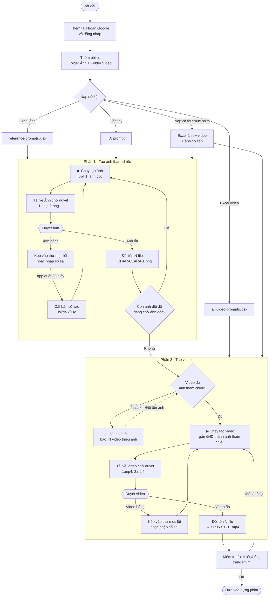
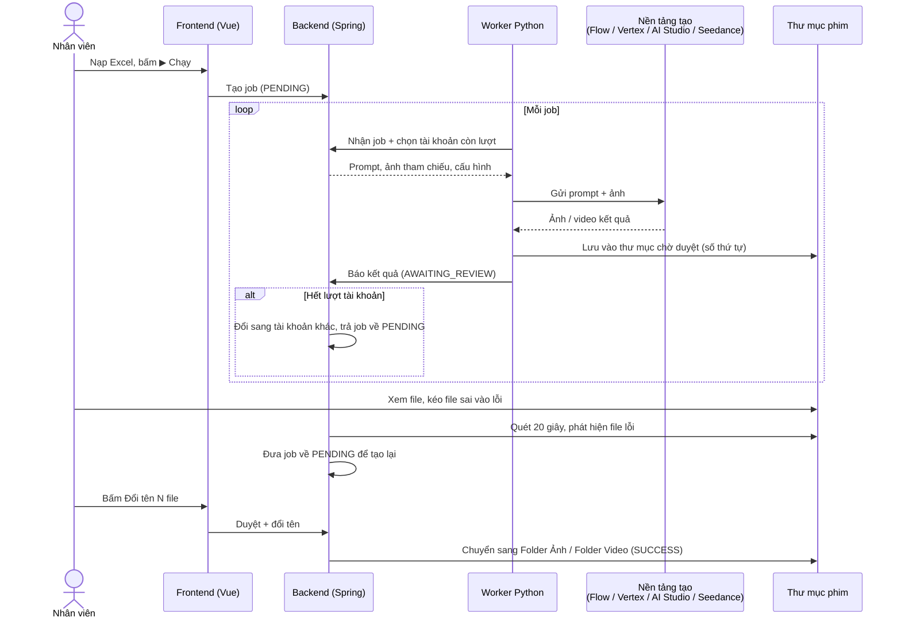
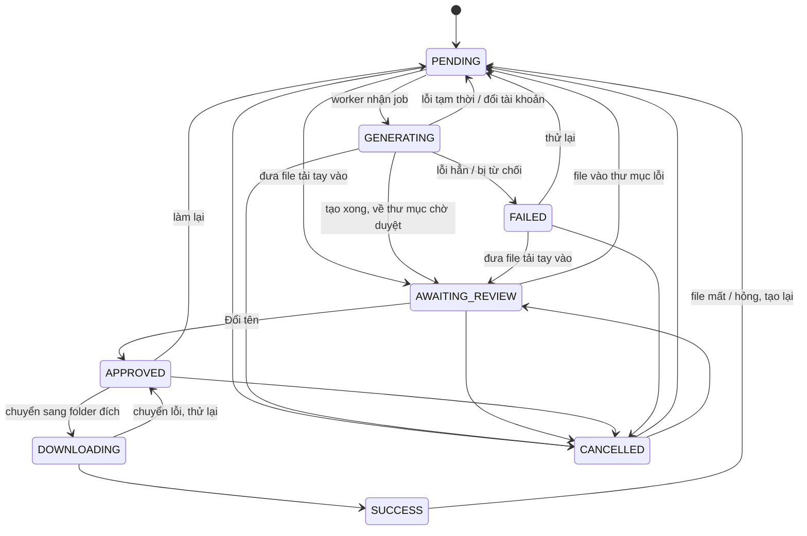

# Luồng nghiệp vụ Flow Batch Studio

Sơ đồ viết bằng [Mermaid](https://mermaid.js.org/): GitHub, GitLab, VS Code (extension *Markdown Preview Mermaid Support*) và IntelliJ tự vẽ khi mở file này.

## 1. Luồng tổng thể một tập phim

## 2. Một job đi qua backend và engine

## 3. Trạng thái của một job (`JobStatus`)

